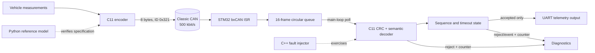
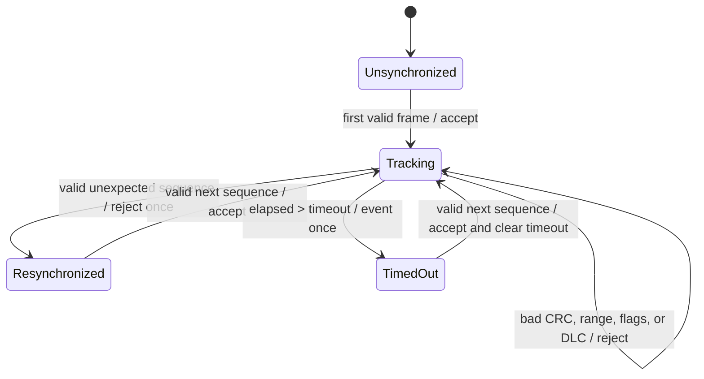

# CAN Vehicle Telemetry — STM32F446RE

[](https://github.com/RohitPatel97/can-vehicle-telemetry/actions/workflows/ci.yml)
[](CMakeLists.txt)
[](apps/simulator.cpp)
[](LICENSE)

A fixed-width vehicle telemetry protocol and embedded integration portfolio for Classic CAN.
It encodes vehicle speed, coolant temperature, and battery voltage into one
eight-byte frame, validates the frame on receipt, and forwards only accepted
telemetry over UART.

The deployable core is allocation-free C11 with no STM32 dependencies. A C++17
host simulator injects faults, a dependency-free Python implementation acts as
an executable protocol oracle, and a narrow STM32Cube HAL adapter demonstrates
the board boundary.

> **Validation boundary:** the portable protocol and STM32 adapter have host
> tests; the adapter uses a HAL/CMSIS test double. This does **not** validate
> real interrupt timing, CAN electrical signaling, the CubeF4 build, or an
> STM32 board. See [Hardware validation](#hardware-validation).

## Problem, solution, and project breakdown

Vehicle measurements can be corrupted, delayed, duplicated, or lost before a
diagnostic consumer sees them. The project encodes bounded engineering values,
validates incoming frames, tracks communication health, and forwards accepted
samples through a separate main-loop UART path.

| Layer | Responsibility | Engineering skills demonstrated |
|---|---|---|
| C11 protocol | Fixed-width serialization, CRC-8, range and flag checks | Embedded C, bitwise operations, endianness, defensive parsing |
| Receiver state machine | Sequence recovery, timeouts, diagnostic counters | State machines, error handling, unsigned timer arithmetic |
| STM32 HAL adapter | Bounded ISR queue, main-loop validation and UART | Interrupt/main concurrency, circular buffers, peripheral abstraction |
| C++17 simulator and Python oracle | Repeatable faults and independent protocol examples | C++, Python, debugging, test automation |
| CMake and GitHub Actions | Compiled suites and asserted simulator outcomes | Unit/integration testing, build systems, CI |

The [problem/solution test cases](docs/test-cases.md) provide concrete inputs,
expected outcomes, source links, and commands an employer can reproduce.
See [WORKFLOW.md](WORKFLOW.md) for completed work and the next three milestones.

### Latest improvement: accurate timeout reporting under load

When interrupts refill the queue during a bounded poll, newer received frames
can still be waiting for validation. Comparing the last processed timestamp
with the current clock at that point could report a false outage. The adapter
now checks queued arrival timestamps in order and checks the current clock only
after atomically observing an empty queue. Three new HAL mock regressions cover
continuous traffic, a real outage across polls, and tick rollover. See the
[reproducible scenarios](docs/test-cases.md#backlog-timeout-regression).

## What this repository demonstrates

- A byte-specified 8-byte Classic CAN payload on standard ID `0x321` at
  500 kbit/s
- Deterministic integer serialization in portable C (no struct casting,
  bitfields, dynamic allocation, or floating point)
- CRC-8, semantic range, reserved-bit, DLC, sequence, timeout, and CAN-driver
  error paths
- A recovery policy that rejects a discontinuous sequence once, then
  resynchronizes for the following frame
- Accepted-only UART forwarding and diagnostic counters
- A 16-frame circular queue that keeps validation and blocking UART out of the
  CAN ISR, with bounded draining and explicit overflow accounting
- Detection of receive gaps even when a recovery frame is queued before polling
- Timeout checks that preserve receive order across bounded polls and backlogs
- Automated C, C++, and Python verification with GCC/Clang and sanitizers

## Architecture



The protocol library knows nothing about CAN registers, interrupts, clocks, or
UART. That separation makes the high-risk parsing and state logic directly
testable on a workstation and keeps platform code auditable.

## Wire protocol

### CAN envelope

| Property | Value |
|---|---|
| CAN mode | Classic CAN 2.0A (11-bit identifier) |
| Standard identifier | `0x321` |
| Nominal bitrate | 500,000 bit/s |
| Frame type | Data frame |
| DLC | 8 |
| Multi-byte order | Little-endian |
| Nominal application period used by simulator | 20 ms (50 Hz) |

### Eight-byte payload

| Byte(s) | Field | Encoding | Valid engineering range |
|---|---|---|---|
| 0 | Sequence | Unsigned 8-bit; increments modulo 256 | `0..255` |
| 1–2 | Vehicle speed | Unsigned 16-bit LE, `raw × 0.01 km/h` | `0.00..300.00 km/h` |
| 3 | Coolant temperature | Unsigned 8-bit, `raw − 40 °C` | `−40..150 °C` (`raw 0..190`) |
| 4–5 | Battery voltage | Unsigned 16-bit LE millivolts | `6000..18000 mV` |
| 6 | Status flags | bit 0 engine running; bit 1 charging; bits 2–7 must be zero | `0x00..0x03` |
| 7 | CRC | CRC over bytes 0–6 | CRC-8/SAE-J1850 |

CRC parameters: polynomial `0x1D`, initial value `0xFF`, final XOR `0xFF`,
input/output not reflected. The standard ASCII check vector `123456789`
produces `0x4B`.

### Golden vector

For sequence 42, speed 123.45 km/h, coolant 92 °C, battery 14.320 V, and
both flags set:

```text
2A 39 30 84 F0 37 03 BE
│  └─speed─┘ │  └batt─┘ │  └ CRC
│            │          └ flags
│            └ coolant raw (92 + 40)
└ sequence
```

The decoder validates in this order: pointer/length, CRC, reserved flag bits,
then engineering ranges. This makes random corruption a CRC failure while
still detecting a malicious or faulty sender that recomputes a valid CRC over
semantically impossible data.

## Quick start

Requirements: CMake 3.20+, a C11/C++17 compiler, and Python 3.10+ for the
reference suite. Run the commands below from the repository root. To try the
protocol without a compiler, start with the
[Python reference suite and frame analyzer](#run-the-compiler-independent-reference-suite).

### Use the portable C API

```c
#include "telemetry/protocol.h"
#include "telemetry/receiver.h"

telemetry_sample_t sample = {
    .speed_centi_kph = 12345,
    .coolant_c = 92,
    .battery_mv = 14320
};
uint8_t payload[TELEMETRY_FRAME_SIZE];

telemetry_status_t status = telemetry_encode(
    &sample,
    42,
    TELEMETRY_FLAG_ENGINE_RUNNING | TELEMETRY_FLAG_CHARGING,
    payload);

/* Send payload as standard CAN ID 0x321 only when status == TELEMETRY_OK. */
```

On reception, retain one `telemetry_receiver_t`, pass each ID-filtered frame to
`telemetry_receiver_process`, and forward the returned `telemetry_decoded_t`
only when the status is `TELEMETRY_OK`. The STM32 adapter demonstrates that
boundary.

### Build the C library, C tests, and C++ simulator

```sh
cmake -S . -B build -DCMAKE_BUILD_TYPE=Debug
cmake --build build --parallel
ctest --test-dir build --output-on-failure
```

The default build treats warnings as errors. To exercise memory/undefined
behavior checks with GCC or Clang:

```sh
cmake -S . -B build-sanitized \
  -DTELEMETRY_ENABLE_SANITIZERS=ON \
  -DCMAKE_BUILD_TYPE=Debug
cmake --build build-sanitized --parallel
ctest --test-dir build-sanitized --output-on-failure
```

### Run deterministic fault injection

```sh
./build/telemetry_sim --frames 8
./build/telemetry_sim --frames 8 --fault crc --fault-at 3
./build/telemetry_sim --frames 8 --fault range --fault-at 3
./build/telemetry_sim --frames 8 --fault sequence --fault-at 3
./build/telemetry_sim --frames 8 --fault timeout --fault-at 3
./build/telemetry_sim --frames 8 --fault can --fault-at 3
```

On a multi-config generator such as Visual Studio, the executable is normally
under `build/Debug/` and `ctest` should receive `-C Debug`.

CTest runs the C protocol suite, the real STM32 adapter linked against a small
HAL/CMSIS test double, and six simulator scenarios with exact expected counter
summaries. The adapter tests inject arrivals during UART calls to check bounded
polling and queue order; they do not simulate CPU scheduling or hardware timing.

Example accepted output is deliberately UART-shaped:

```text
RX[0] 00 68 10 7A E8 35 03 CD -> ok
UART> TEL,0,42.00,82,13800,3
```

Rejected frames are printed with their exact status and never receive a
`UART>` line. The final summary exposes accepted and error counters.

### Run the compiler-independent reference suite

Only Python 3.10+ is required; there are no packages to install:

```sh
python -m unittest discover -s tests -p "test_*.py" -v
```

Decode a captured payload with the analyzer:

```sh
python scripts/analyze_frames.py "2A 39 30 84 F0 37 03 BE"
```

Output:

```json
{"battery_v": 14.32, "coolant_c": 92, "flags": 3, "input": "2A 39 30 84 F0 37 03 BE", "sequence": 42, "speed_kph": 123.45, "status": "ok"}
```

Pass multiple frames with `--stateful` to enforce sequence order. With no frame
arguments, newline-delimited hex frames are read from standard input.

## Receiver behavior



- Sequence arithmetic is modulo 256, so `254 → 255 → 0 → 1` is valid.
- On a mismatch, the valid received sequence becomes the new baseline. This
  avoids permanently rejecting traffic after one lost CAN frame.
- A rejected sequence frame is not forwarded and does not refresh the last
  accepted timestamp.
- Timeout uses unsigned 32-bit subtraction and therefore works across one
  `HAL_GetTick()` rollover. A timeout event counter increments only on entry to
  the timed-out state, not on every poll.
- CAN controller errors enter through an explicit platform hook and have their
  own counter.
- The STM32 adapter records arrival timestamps in its ISR queue and checks for
  a timeout before processing each queued frame. A `0 ms → 300 ms` receive gap
  with a 250 ms limit is reported even if both frames are drained in one poll.
  `poll()` returns whether a new outage occurred; `receiver.timed_out` reports
  whether the outage remains active after processing any recovery traffic.
- If a bounded poll leaves frames queued, it defers the current-clock timeout
  check. Those frames may bridge the apparent gap since the last processed
  sample. Subsequent polls still detect actual gaps from arrival timestamps;
  once the queue drains, current-clock checks resume. During a backlog,
  `receiver.timed_out` describes processed receive history, so outage reporting
  can be delayed until that history is consumed.

### Interrupt and main-loop ownership

The CAN callback copies one raw frame, CAN envelope, and receive tick into a
16-slot circular buffer. Short critical sections preserve the caller's PRIMASK
and protect the queue/counter handoff. A full queue drops the newest frame and
counts the overrun; it never overwrites unread data. The main-loop poll drains
at most 16 frames, rechecks standard ID/data-frame/DLC, validates the payload,
and performs UART formatting/transmission only after acceptance. UART failures
are counted and the sample is not retried, so this diagnostic path can lose
output without causing a previously accepted CAN sample to be replayed.

This adapter assumes single-core bare-metal Cortex-M execution. Initialize it
before enabling CAN interrupts; call `poll()` with interrupts enabled and read
public receiver/diagnostic state only from that same main context. Multiple
RTOS consumers require a different synchronization contract.

## Test evidence

| Behavior | C host test | Python oracle test | Simulator/CI |
|---|:---:|:---:|:---:|
| CRC-8 `123456789 → 0x4B` | ✓ | ✓ | Build gate |
| Golden byte order and round trip | ✓ | ✓ | Normal run |
| Minimum/maximum engineering values | ✓ | ✓ | — |
| Encode-time range and flag rejection | ✓ | ✓ | — |
| Corrupted payload / stale CRC | ✓ | ✓ | `--fault crc` |
| Impossible speed with recomputed CRC | ✓ | ✓ | `--fault range` |
| Reserved status bits | ✓ | ✓ | — |
| Wrong DLC/length | ✓ | ✓ | — |
| Sequence rollover | ✓ | ✓ | Normal run |
| Sequence jump and resynchronization | ✓ | ✓ | `--fault sequence` |
| Timeout transition and tick rollover | ✓ | ✓ | `--fault timeout` |
| CAN controller error accounting | ✓ | ✓ | `--fault can` |
| ISR deferral, PRIMASK restoration, accepted-only UART | HAL mock | — | CTest gate |
| Envelope/DLC rejection and HAL/UART failure paths | HAL mock | — | CTest gate |
| Queue overflow, order, recovery, bounded refill | HAL mock | — | CTest gate |
| Queued receive gap followed by recovery in one poll | HAL mock | — | CTest gate |
| Continuous backlog, real gap across polls, and backlog tick rollover | HAL mock | — | CTest gate |

Local verification snapshot (2026-10-01): a Windows CMake/Ninja build with
Zig 0.16.0 / Clang 21.1.0 passed **8 C protocol cases**, **15 HAL mock cases**,
and all **8 CTest entries**. The Python reference suite passed **13 tests**.
The three new HAL regressions failed against the previous adapter (12 failed
assertions) and passed after the fix. Strict warnings remain enabled, including
`-Wconversion -Werror`. The local CMake build used an explicit Zig archive-rule
override; GCC/Clang and sanitizer validation are separate GitHub CI checks.
These results establish host behavior, not physical CAN/UART timing or a Cube
firmware build.

Earlier verification snapshot (2026-09-04): fresh native Zig 0.16.0 / Clang 21.1.0
builds passed **8 C protocol cases**, **12 HAL mock integration cases**, and all
**8 CTest entries** (the two C suites plus six simulator scenarios). The
dependency-free Python suite passed **13 tests**. C and C++ builds used strict
warnings including `-Wconversion -Werror`. Windows CMake did not autodetect an
archive tool, so the local executables were built directly with `zig cc` and
`zig c++` before running the configured CTest entries. The full standard CMake
build and GCC/Clang sanitizer checks run in GitHub CI. None of these tests
establish physical CAN/UART behavior or a complete Cube firmware build.

Earlier verification snapshot (2026-08-26): the dependency-free Python suite ran
13 tests successfully. A C/C++ compiler was not available in the authoring
environment, so compiled tests were not claimed locally; the checked-in GitHub
Actions workflow builds and runs them under both GCC and Clang and adds a GCC
AddressSanitizer/UndefinedBehaviorSanitizer job.

## STM32F446RE integration

The adapter targets the STM32CubeF4 `HAL_CAN_*` API (bxCAN):

1. Add the two portable sources and the platform adapter to a CubeIDE project.
2. Add `include/` and `platform/stm32f446re/` to the include search path.
3. Configure a physical CAN transceiver, CAN RX/TX pins, UART, interrupts, and
   termination appropriate to the board.
4. Adapt the provided [integration example](examples/stm32f446re/main_integration_example.c)
   inside CubeMX `USER CODE` sections.

The example's 500 kbit/s timing assumes a 45 MHz CAN peripheral clock:

```text
45 MHz / prescaler 6 / (1 sync + 11 BS1 + 3 BS2) = 500 kbit/s
```

Recalculate bit timing if the APB1 clock differs. The CAN ISR queues raw frames;
call `telemetry_application_poll()` frequently from the main loop. UART remains
blocking in main context with a 10 ms timeout per accepted sample, so a full
16-frame drain can spend up to 160 ms in UART waits alone. Sustained traffic,
peripheral stalls, and application scheduling need board-level measurement;
DMA/non-blocking UART is a future integration option.

## UART format

Accepted samples use an ASCII, comma-separated diagnostic line:

```text
TEL,<sequence>,<speed_kph>,<coolant_c>,<battery_mv>,<flags>\r\n
```

Example: `TEL,42,123.45,92,14320,3`. UART is a diagnostic transport here, not
part of the CAN wire protocol.

## Design decisions

| Decision | Rationale | Trade-off |
|---|---|---|
| Fixed 8-byte frame | Fits one Classic CAN frame; bounded parsing and latency | No room for timestamp or protocol version |
| Integer engineering units | Repeatable on MCU/host; no float ABI or rounding drift | Callers convert units at UI boundaries |
| Explicit little-endian writes | Portable across CPUs and compilers | A few more lines than packed-struct casting |
| CRC plus semantic validation | Separates corruption detection from plausible-value policy | One payload byte is consumed by CRC |
| Strict next-sequence check with resync | Detects loss/duplicate/reordering and recovers on next frame | The discontinuous frame itself is discarded |
| Platform-neutral core | Unit-testable without hardware or STM32 HAL | Requires a small integration adapter |
| No dynamic allocation | Predictable memory use and embedded suitability | Caller owns all state/output storage |

## Repository layout

```text
.
├── .github/workflows/ci.yml          # GCC, Clang, sanitizers, fault smoke runs
├── apps/simulator.cpp                # C++ host simulator and fault injector
├── docs/hardware-validation.md       # honest board-level validation plan
├── docs/test-cases.md                # reproducible problem/solution scenarios
├── examples/stm32f446re/             # Cube HAL integration excerpt
├── include/telemetry/
│   ├── protocol.h                    # wire-format API and constants
│   └── receiver.h                    # sequence/timeout state and statistics
├── platform/stm32f446re/             # thin HAL_CAN/HAL_UART adapter
├── scripts/analyze_frames.py         # captured-frame JSON analyzer
├── src/
│   ├── protocol.c                    # CRC, encoder, decoder
│   └── receiver.c                    # receiver state machine
├── tests/
│   ├── test_telemetry.c              # compiled C unit suite
│   ├── test_stm32_hal.c              # real adapter with host HAL/CMSIS double
│   ├── mocks/stm32f4xx_hal.h          # test-only HAL surface, never for firmware
│   └── test_reference.py             # compiler-independent specification tests
├── tools/telemetry_reference.py      # executable Python protocol oracle
├── CMakeLists.txt
├── CHANGELOG.md
├── CONTRIBUTING.md
└── LICENSE
```

## Hardware validation

No oscilloscope trace, CAN analyzer capture, or board UART log is included, so
this repository does not claim physical-layer or on-target validation. The
[hardware validation plan](docs/hardware-validation.md) lists the equipment,
stimuli, expected observations, and evidence needed to make that claim later.

## Current limitations

- Classic CAN only; CAN FD and extended identifiers are out of scope.
- No authentication or freshness guarantee beyond an 8-bit sequence counter.
  CRC detects accidental corruption, not intentional modification.
- No version field. A breaking payload change needs a new CAN ID or an explicit
  migration plan.
- The reference timeout assumes gaps shorter than one full 32-bit tick cycle.
- The sample UART is diagnostic and blocking in the main loop. Queue capacity
  is finite and overload drops the newest frame. Real-time throughput and
  interrupt latency have not been measured on a board.
- Bus-off recovery policy remains application-specific because safety goals and
  network ownership differ between systems.

## License

MIT — see [LICENSE](LICENSE).
